 

 

<table>
  <tr>
    <td width="42%" valign="middle" align="center">
      <picture>
        <source media="(prefers-color-scheme: dark)" srcset="portrait.svg">
        
      </picture>
       
      Rendered from a photo by a Python pipeline: background removal, bilateral filter, CLAHE, then ASCII, re-generated by GitHub Actions.
    </td>
    <td width="58%" valign="top">
      <h3>I build software people actually use</h3>
      
Six shipped products across web, mobile and developer tooling, most of them live today. I care about the unglamorous parts: deterministic data layers, honest UX, and code that is easy to change.

      <table>
        <tr><td><b>Now</b></td><td>Building <a href="https://koda-github.vercel.app">KODA</a>, a codebase intelligence platform</td></tr>
        <tr><td><b>Focus</b></td><td>Full-stack TypeScript, Python APIs, Flutter apps, AI agents</td></tr>
        <tr><td><b>Approach</b></td><td>Ground AI in structured data, ship small, iterate in public</td></tr>
        <tr><td><b>Community</b></td><td>Active in SRMIST's <a href="https://chat-club-srm.vercel.app">CHAT</a> cybersecurity club</td></tr>
        <tr><td><b>Open to</b></td><td>Internships, collaborations, and interesting problems</td></tr>
      </table>
    </td>
  </tr>
</table>

 

## Activity

  

Generated by [`scripts/generate_stats.py`](scripts/generate_stats.py) every 6 hours via GitHub Actions. No third-party stat services involved.

 

## Featured projects

<table>
  <tr>
    <td width="50%" valign="top">
      <h3><a href="https://koda-github.vercel.app">KODA</a></h3>
      
<b>Codebase intelligence that doesn't hallucinate.</b> Parses a repository into a deterministic dependency graph first, then lets AI agents reason over that graph instead of raw source.

      
  

      <a href="https://koda-github.vercel.app">Live demo</a> · <a href="https://github.com/Arunan-Kavirajan/KODA">Source</a>
    </td>
    <td width="50%" valign="top">
      <h3><a href="https://algorithm-laboratory.vercel.app">Algorithm Laboratory</a></h3>
      
<b>Watch algorithms run, then race them.</b> Step through sorting, searching and graph algorithms line by line, or benchmark two head to head. Algorithms execute natively in Python and stream back trace snapshots.

      
  

      <a href="https://algorithm-laboratory.vercel.app">Live demo</a> · <a href="https://github.com/Arunan-Kavirajan/algorithm-laboratory">Source</a>
    </td>
  </tr>
  <tr>
    <td width="50%" valign="top">
      <h3><a href="https://certiva-seven.vercel.app">Certiva</a></h3>
      
<b>Certificates, without the chaos.</b> Browser-based bulk certificate automation for events, workshops and competitions. Upload a template, map the fields, export hundreds.

      
 

      <a href="https://certiva-seven.vercel.app">Live demo</a> · <a href="https://github.com/Arunan-Kavirajan/Certiva">Source</a>
    </td>
    <td width="50%" valign="top">
      <h3><a href="https://github.com/Arunan-Kavirajan/D-Brownies-Billing-App">D Brownies Billing App</a></h3>
      
<b>Point-of-sale for a real food stall.</b> Offline-first orders, menu management, Bluetooth thermal receipt printing and a business reports suite with best sellers and peak-hour analysis.

      
 

      <a href="https://github.com/Arunan-Kavirajan/D-Brownies-Billing-App">Source</a>
    </td>
  </tr>
  <tr>
    <td width="50%" valign="top">
      <h3><a href="https://ascend-study.vercel.app">Ascend</a></h3>
      
<b>Deep work with accountability.</b> Focus timers, progression mechanics, live peer presence and procedural ambient sound in a distraction-free workspace.

      
 

      <a href="https://ascend-study.vercel.app">Live demo</a>
    </td>
    <td width="50%" valign="top">
      <h3><a href="https://echoes-sandy.vercel.app">Echoes</a></h3>
      
<b>An anonymous time capsule.</b> Messages drift across a starfield, grouped into monthly constellations. No accounts, no likes, no feed, no tracking.

      
 

      <a href="https://echoes-sandy.vercel.app">Live demo</a>
    </td>
  </tr>
</table>

More case studies, including private systems, live in **[Project Exhibit](https://github.com/Arunan-Kavirajan/project-exhibit)**.

 

## Toolbox

| | |
|---|---|
| **Languages** |     |
| **Frontend** |      |
| **Mobile** |   |
| **Backend** |    |
| **Tooling** |     |

 

Everything on this page, including the portrait and the activity dashboard, is generated and refreshed automatically. Source: <a href="scripts/generate_portrait.py">portrait</a> · <a href="scripts/generate_stats.py">stats</a> · <a href=".github/workflows">workflows</a>

