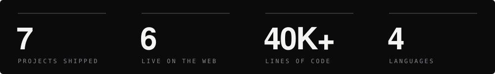
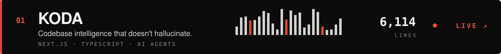
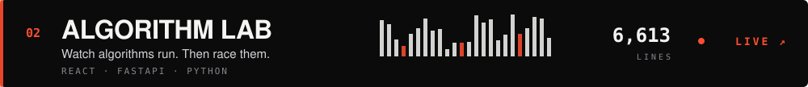
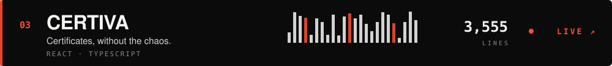
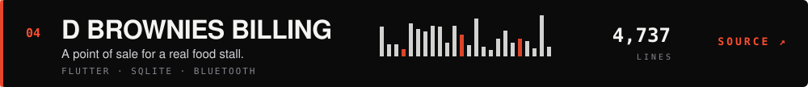
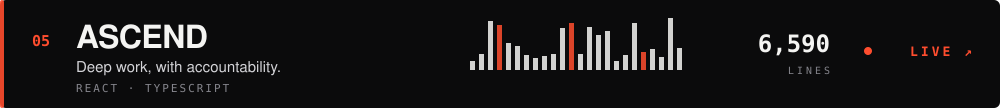
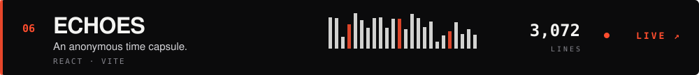
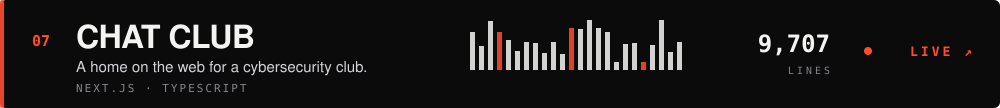

  <a href="https://arunan-kavirajan.vercel.app"><code>PORTFOLIO ↗</code></a>&nbsp;&nbsp;
  <a href="https://www.linkedin.com/in/arunan-kavirajan"><code>LINKEDIN ↗</code></a>&nbsp;&nbsp;
  <a href="https://github.com/Arunan-Kavirajan/project-exhibit"><code>FULL EXHIBIT ↗</code></a>

