 

 
 

## ◆ SELECTED WORK ◆

<table>
  <tr>
    <td width="50%"></td>
    <td width="50%"></td>
  </tr>
  <tr>
    <td width="50%"></td>
    <td width="50%"></td>
  </tr>
  <tr>
    <td width="50%"></td>
    <td width="50%"></td>
  </tr>
</table>

 

## ◆ ACTIVITY ◆

 

## ◆ SIGNATURE ◆

<picture>
  <source media="(prefers-color-scheme: dark)" srcset="portrait.svg">
  
</picture>

Photo → background removal → bilateral filter → CLAHE → ASCII → animated SVG. Written in Python, rebuilt by GitHub Actions.

 
 

Every visual on this page is generated code: <a href="scripts/generate_assets.py">assets</a> · <a href="scripts/generate_stats.py">stats</a> · <a href="scripts/generate_portrait.py">portrait</a>

